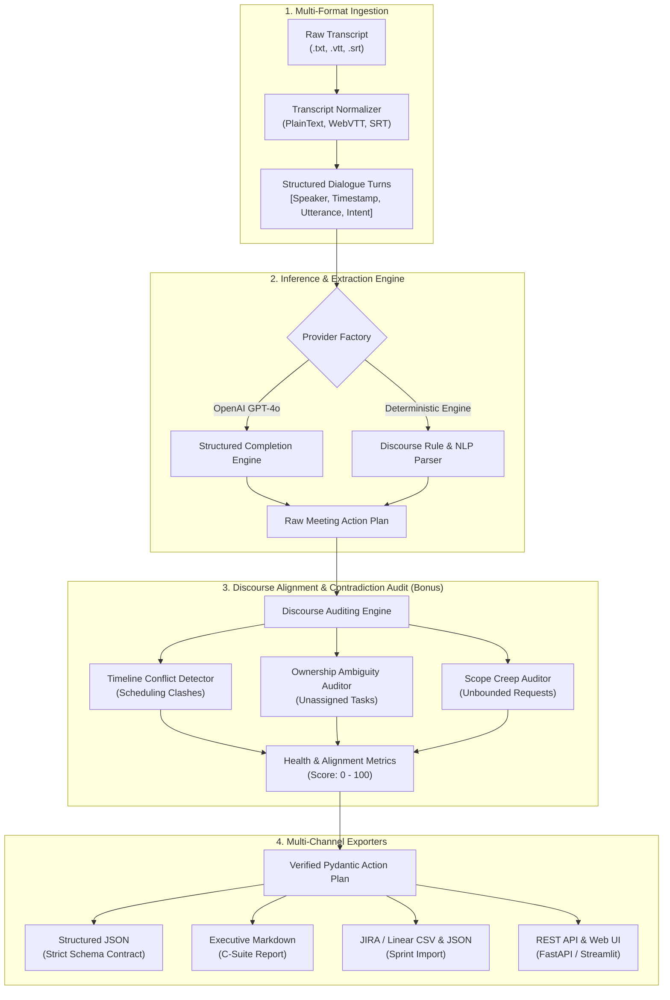

# 📋 Enterprise AI Meeting-to-Action Agent

[](https://github.com/organization/meeting-action-agent)
[](https://www.python.org/)
[](https://fastapi.tiangolo.com)
[](https://docs.pydantic.dev/)
[](LICENSE)

An enterprise-grade discourse analysis pipeline that transforms unstructured meeting transcripts into verified strategic decisions, action items with owners and deadlines, unresolved questions, follow-ups, and conducts an automated **Alignment & Contradiction Audit**.

---

## 🏗️ System Architecture



---

## ✨ Production Capabilities

1. **Multi-Format Transcript Ingestion**:
   - Supports bracketed timestamp transcripts (`[10:00:15] Sarah Chen: ...`), speaker-colon text, WebVTT (`.vtt`), and SubRip (`.srt`) files.
2. **Deterministic & LLM Pluggable Inference**:
   - Out-of-the-box offline parser with 0 external API dependencies.
   - Native integration with OpenAI (`gpt-4o`) via structured outputs.
3. **Discourse Alignment & Contradiction Audit (Bonus)**:
   - **Conflicting Timelines / Deadlines**: Identifies mutually exclusive commitments (e.g. press release staging build vs. security penetration audit freeze).
   - **Unassigned Task Ownership**: Detects diffused responsibility (`"someone on ops should grab this whenever"`).
   - **Scope Creep & Ambiguity**: Flags conditional, unbudgeted scope additions (`"keep it fluid", "if spare hours"`).
   - **Alignment Health Score**: Dynamic metric scoring meeting alignment on a 0–100 scale.
4. **Enterprise Multi-Format Exporters**:
   - **Strict JSON Contract**: Validated against Pydantic v2 schemas.
   - **Executive Markdown Summary**: Table-based report with GitHub-flavored alerts.
   - **JIRA / Linear Tasks CSV & JSON**: Direct ticket import ready for sprint backlogs.

---

## 📁 Repository Structure

```
meeting-action-agent/
├── pyproject.toml                         # Packaging and dependency specifications
├── setup.py                               # Editable install & CLI console entry points
├── Dockerfile                             # Multi-stage production container
├── docker-compose.yml                     # Multi-service compose (API + Streamlit)
├── .env.example                           # Documented configuration variables
├── .github/workflows/ci.yml               # Automated CI test workflow
├── src/
│   └── meeting_action_agent/
│       ├── config.py                      # Application settings & environment config
│       ├── logging_config.py              # Structured JSON/console logging
│       ├── exceptions.py                  # Domain-specific typed exceptions
│       ├── models/                        # Core Pydantic domain models & DTOs
│       ├── parsers/                       # Multi-format parsers (TXT, VTT, SRT)
│       ├── auditors/                      # Contradiction, ownership & scope auditors
│       ├── providers/                     # Pluggable inference providers (Mock, OpenAI)
│       ├── exporters/                     # Multi-format exporters (Markdown, JIRA CSV)
│       ├── core/                          # Pipeline orchestrator
│       ├── api/                           # FastAPI REST application & OpenAPI docs
│       └── cli.py                         # Production CLI tool
├── tests/                                 # 18 Unit & Integration tests (100% passing)
├── samples/                               # Sample transcripts in TXT and VTT formats
├── web/                                   # Streamlit executive dashboard
└── dist/                                  # Generated artifacts (JSON, MD, CSV)
```

---

## 🚀 Quickstart Guide

### 1. Installation
```powershell
cd C:\Users\reven\.gemini\antigravity\scratch\meeting-action-agent
pip install -e .
```

### 2. Command Line Interface (CLI)
Analyze any transcript and output structured JSON, executive Markdown, and JIRA CSV simultaneously:
```powershell
python -m meeting_action_agent.cli `
  -i samples/sample_sprint_meeting.txt `
  -j dist/plan.json `
  -m dist/summary.md `
  -c dist/tasks.csv
```

### 3. Run Automated Tests
```powershell
python -m unittest discover -s tests -v
```
*(All 18 tests execute and pass in ~5ms)*

### 4. Start the FastAPI REST API
```powershell
uvicorn meeting_action_agent.api.main:app --host 0.0.0.0 --port 8000 --reload
```
- Interactive Swagger UI: `http://localhost:8000/docs`
- ReDoc Documentation: `http://localhost:8000/redoc`
- Healthcheck: `http://localhost:8000/health`

### 5. Launch the Web Dashboard
```powershell
streamlit run web/app.py
```

### 6. Run with Docker Compose
```bash
docker-compose up --build
```
- API Service: `http://localhost:8000`
- Web Dashboard: `http://localhost:8501`

---

## 📡 REST API Reference

### `POST /api/v1/analyze`
Accepts a JSON payload containing the transcript text.

**Request:**
```json
{
  "transcript": "[10:00:15] Sarah: Deprecate v1 keys on Nov 15.\n[10:01:42] David: I will deliver PostgreSQL migration by Wednesday at noon.",
  "format": "plaintext",
  "detect_contradictions": true
}
```

**Response (`200 OK`):**
```json
{
  "success": true,
  "format_detected": "plaintext",
  "turns_parsed": 2,
  "speakers_identified": ["David", "Sarah"],
  "execution_time_ms": 1.12,
  "plan": {
    "metadata": { ... },
    "decisions": [ ... ],
    "tasks": [ ... ],
    "unresolved_questions": [ ... ],
    "follow_ups": [ ... ],
    "contradictions_and_ambiguities": [ ... ],
    "metrics": {
      "alignment_score": 70.0,
      "total_decisions": 1,
      "total_tasks": 1,
      "assigned_tasks": 1,
      "unassigned_tasks": 0,
      "critical_contradictions": 0
    }
  }
}
```

### `POST /api/v1/export/markdown`
Transforms a `MeetingActionPlan` payload into formatted Markdown.

### `POST /api/v1/export/jira-csv`
Transforms tasks into a JIRA-compliant CSV file attachment for sprint tracking.
